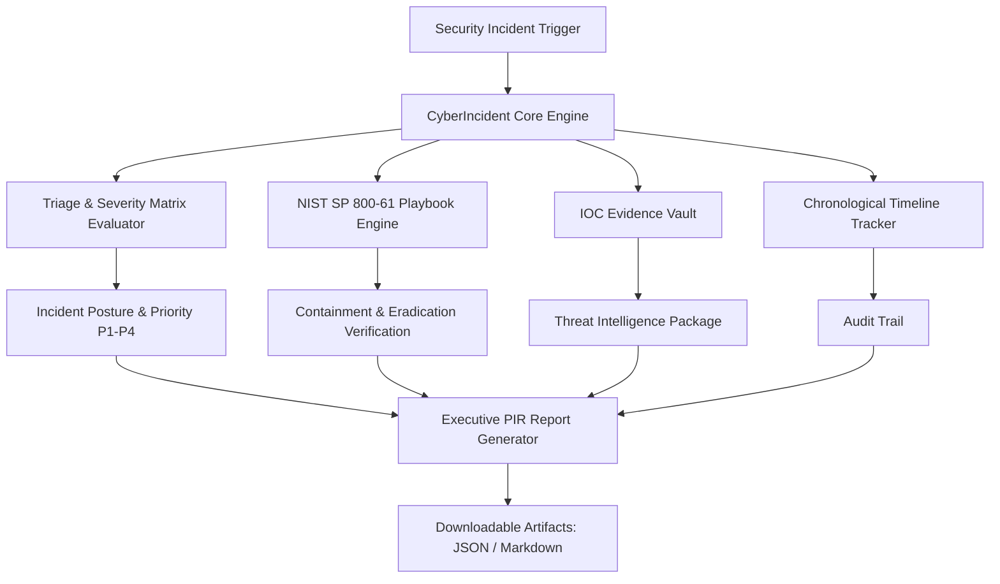

# 🚨 CyberIncident — Cyber Incident Response Assistant

[](https://www.python.org/)
[](https://streamlit.io/)
[-red.svg)](https://csrc.nist.gov/publications/detail/sp/800-61/rev-2/final)
[](LICENSE)

**CyberIncident** is a digital forensics and incident response (DFIR) orchestration platform designed to streamline security incident management according to the **NIST SP 800-61** standard. It automates incident severity classification (P1 Critical through P4 Low), provides interactive attack-vector playbooks (Ransomware, BEC/Phishing, DDoS), manages Indicators of Compromise (IOCs), records chronological operational timelines, and compiles professional executive Post-Incident Reports (PIR).

---

## 🌟 Key Features

- **🚦 Dynamic Severity Classification Engine**: Categorizes incidents (P1 Critical, P2 High, P3 Medium, P4 Low) based on attack vectors, scope of affected systems, confidentiality impact, and operational outage.
- **📖 NIST SP 800-61 Interactive Playbooks**:
  - **Ransomware / Extortion Playbook**: Rapid containment, isolation checklists, canary verification, and offline restoration.
  - **Phishing & BEC Playbook**: Tenant mailbox trace, session revocation, OAuth app audit, and MFA enforcement.
  - **DDoS Mitigation Playbook**: Flow analysis, upstream BGP blackholing, and CDN rate-limit tuning.
- **🔬 Live IOC Evidence Vault**: Real-time logging of threat artifacts (C2 IPs, Domains, SHA-256 malware digests, compromised credentials).
- **⏱️ Chronological Action Timeline**: Step-by-step audit logging of containment actions, forensic captures, and operator observations.
- **📑 Executive Post-Incident Report (PIR) Generator**: One-click generation of comprehensive management documentation exportable in **JSON** and **Markdown**.

---

## 🏗️ System Architecture



---

## 🚀 Quick Start Guide

### Prerequisites
- Python 3.9 or higher installed.

### 1. Clone the Repository
```bash
git clone https://github.com/YOUR_USERNAME/CyberIncident-IncidentResponseAssistant.git
cd CyberIncident-IncidentResponseAssistant
```

### 2. Set Up Virtual Environment
```bash
# Windows
python -m venv venv
venv\Scripts\activate

# macOS / Linux
python3 -m venv venv
source venv/bin/activate
```

### 3. Install Requirements
```bash
pip install -r requirements.txt
```

### 4. Run CyberIncident
```bash
streamlit run app.py
```
Open your browser at `http://localhost:8501`.

---

## 📁 Project Structure

```
CyberIncident-IncidentResponseAssistant/
│
├── app.py                 # Core Streamlit incident management dashboard
├── requirements.txt       # Project dependencies
├── README.md              # Project documentation & GitHub showcase
└── PROJECT_REPORT.md      # Comprehensive academic & technical report
```

---

## 🛡️ License
Distributed under the MIT License. See `LICENSE` for details.
